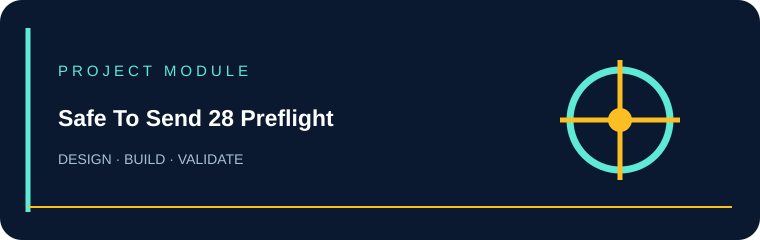
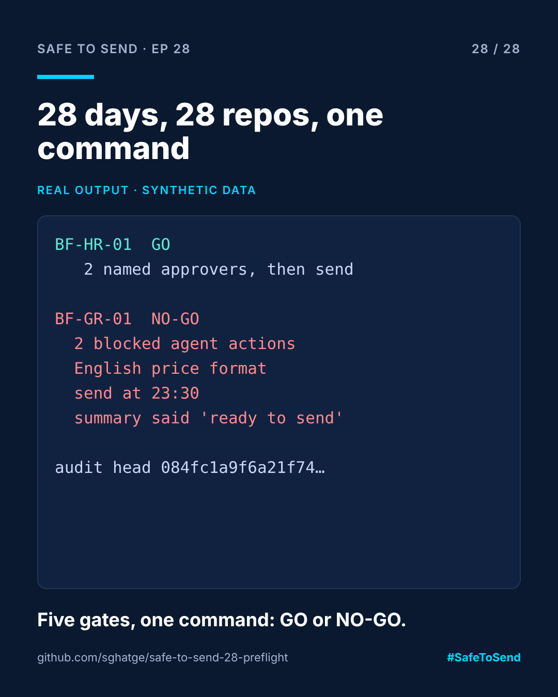

<div align="center">



**SAFE TO SEND · GOVERNED AI ENGINEERING SERIES · SAFE TO SEND 28 PREFLIGHT**

[GitHub Profile](https://github.com/sghatge) · [Portfolio](https://sghatge.github.io/adobe-campaign-v8-governance/)

</div>

---

# safe-to-send-28 · Preflight



**Safe to Send · Episode 28** — the final episode of a 28-day learn-in-public series on governing AI in CRM operations.

> Twenty-seven small ideas, one command.

## What it does

`preflight` takes a campaign package (the AI agent's tool calls, the delivery, and the model-written summary for the market) and runs five gates in order:

| Gate | Question | From episode |
|---|---|---|
| Policy | Did the agent try anything it must never do? | 02, 03 |
| QA | Is the delivery itself correct? | 05 |
| Lock | Does the summary tell the truth about the result? | 12 |
| Approvals | Who must sign before it goes? | 13 |
| Audit | Is every result recorded so it can't be quietly changed? | 06 |

It ends with **GO** or **NO-GO**, every reason, and the audit head hash to store somewhere the agent can't write.

## Run it

```bash
python preflight.py examples/hr_package.json examples/gr_package.json
```

## Real example output

```
BF-HR-01 (HR, 142,800 recipients): GO
   next: 2 named approver(s), then send
   audit head: 95a7a479e88539b0…

BF-GR-01 (GR, 312,500 recipients): NO-GO
   - agent attempted 2 blocked action(s): query_run, data_export
   - QA: English price format
   - QA: send at 23:30 outside 08:00-21:00
   - summary: summary gives a green light on a failed delivery
   audit head: 084fc1a9f6a21f74…
```

Croatia is a GO, with two approvers needed. Greece is a NO-GO: two blocked agent actions, two QA failures, and a summary that called the failed delivery "ready to send". Store the audit head hash outside the system (see Episode 06 for why).

## The whole series

Every gate here has its own repo, explanation and real example. Start from the index: [safe-to-send-21-series-map](https://github.com/sghatge/safe-to-send-21-series-map).

## What I'd build next

A real adapter to a campaign platform, behind an operator with tightly scoped rights. Everything in this series runs on synthetic data, and the governance pattern is the same either way.

MIT · [Sangram Ghatge](https://www.linkedin.com/in/sangram-g-2369705b) · #SafeToSend


---

## Portfolio integration & safe use

This repository is part of the **Safe to Send** 28-episode engineering series on governed AI for CRM and marketing operations.

- [Series index and episode map](https://github.com/sghatge/safe-to-send-21-series-map)
- [Complete portfolio](https://github.com/sghatge/sghatge)
- [OPSFORGE Build Lab](https://sghatge.streamlit.app/) — portfolio overview; this repository remains independently usable without the Build Lab.

**Safe-use boundary:** use the supplied examples and synthetic data for evaluation. Review the implementation, dependencies and tests before adapting it. Do not connect it to a production CRM, customer dataset or activation endpoint without a separate security, privacy and change-control review. No production integration or deployment is implied by this repository.
